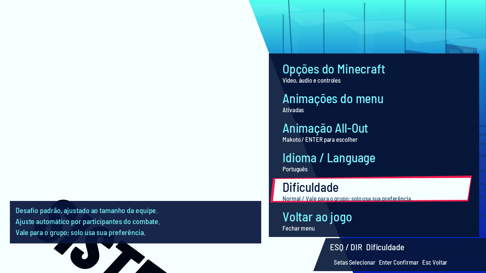
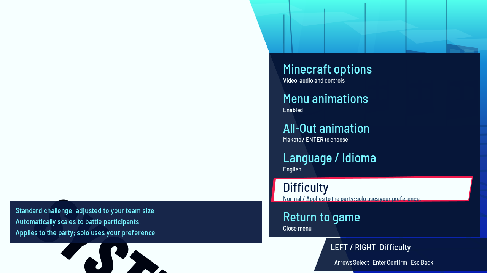

# Dificuldade e tamanho do grupo — 0.6.54

O seletor fica em **TAB → System → Dificuldade**. Clique ou Enter avança; esquerda/direita alternam nos dois sentidos. **Normal** é o padrão. A opção e as explicações seguem o idioma escolhido no mod.

| Opção | Resistência dos inimigos | Dano dos inimigos | Tempo base da Sacerdotisa |
|---|---:|---:|---:|
| Tranquilo | 70% | 50% | 7min30 |
| Fácil | 85% | 75% | 6min |
| Normal | 100% | 100% | 5min |
| Difícil | 120% | 130% | 5min |

Esses multiplicadores se combinam com o tamanho real da equipe no combate. A referência é o balanceamento anterior para quatro jogadores em Normal:

| Participantes | Vida dos inimigos | Dano dos inimigos |
|---|---:|---:|
| 1 | 40% | 60% |
| 2 | 60% | 75% |
| 3 | 80% | 90% |
| 4 | 100% | 100% |
| 5 ou mais | +25 pontos percentuais de vida por participante adicional | 100% |

Exemplo: solo em Fácil usa 34% da vida e 45% do dano da referência; dois jogadores em Normal usam 60% da vida e 75% do dano. O modo Tranquilo também transforma os golpes de morte instantânea lançados por inimigos contra jogadores em dano que deixa ao menos 1 HP. Outros ataques continuam podendo derrotar o jogador. Fraquezas, resistências, habilidades, equipamentos, custos e recompensas mantêm suas regras.

## Solo, líder e persistência

- Solo: a preferência pertence ao jogador e é salva no mundo, incluindo troca da entidade após morte.
- Party: o **líder escolhe para todos**, conforme a decisão do usuário. A escolha fica salva no grupo, inclusive se o líder estiver offline; nesse caso outro integrante não recebe permissão automaticamente.
- Ao sair da party, o jogador volta à sua preferência pessoal. Ao trocar de líder por saída, a party mantém sua escolha até o novo líder alterá-la.
- O servidor rejeita valores desconhecidos e alterações por não líderes, durante combates ou enquanto integrantes participam de uma raid. Não basta alterar o estado visual do menu.
- Cada encontro fixa a dificuldade no início. Um jogador que entra em uma batalha existente usa a dificuldade daquela batalha.

## Participantes e raid

O ajuste conta jogadores presentes na sessão, incluindo os derrotados que ainda fazem parte dela. Não usa o tamanho máximo configurado, jogadores offline ou integrantes distantes que não entraram na luta. Personagens derrotados não reduzem artificialmente a dificuldade.

Entrar ou sair recalcula vida máxima e dano dos inimigos a partir dos valores originais, preservando o progresso percentual da vida. A contabilidade de arredondamento impede que repetir entradas/saídas cure ou cause dano gratuito. Inimigos já derrotados continuam derrotados. A entrada pelo servidor aguarda o fim de ações e animações reservadas, preservando o impacto já calculado.

A raid usa uma referência fixa de quatro jogadores antes de aplicar o mesmo balanceamento, evitando multiplicar o tamanho do grupo duas vezes. A escolha do líder é fixada ao iniciar a operação. Para grupos maiores que quatro, o tempo base da Sacerdotisa também cresce por `participantes / 4`, acomodando a maior quantidade de animações de turno. As penalidades de fase continuam sendo aplicadas uma vez por limiar, e a vitória encerra o cronômetro.

## Compatibilidade e validação

O protocolo do menu passa a **7**; o da cidade permanece **8** nesta versão. Cliente e servidor devem usar a 0.6.54. Mundos anteriores começam em Normal quando não existe preferência salva.

`difficultyTest` verifica os quatro modos com 1–64 participantes, política do líder, persistência pessoal e da party, morte instantânea em Tranquilo, dano real, golpes reservados, entradas/saídas sem restauração de HP, cronômetros e layout do System. Também são verificadas as regras existentes de multiplayer, táticas, raid e localização. As prévias usam o código real do menu.

Verificações offline não equivalem a teste de jogabilidade no Minecraft. Os multiplicadores são a primeira calibração desta funcionalidade; ajustes posteriores podem usar os combates relatados pelo usuário.

Resultados: **3.891** verificações da dificuldade, **4.099** de multiplayer, **12.070** de táticas, **401** da raid e **2.649** de localização aprovadas. Prévia do System conferida após ajustar o painel às seis opções e os controles à fonte utilizada. Relatório reproduzível em `build/reports/difficulty/validation.json`.

