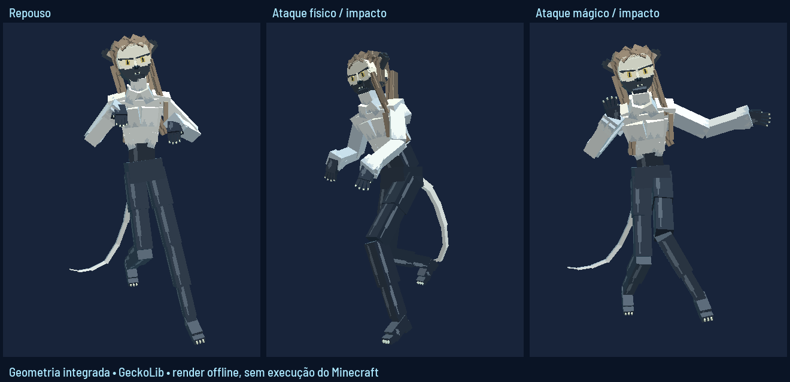
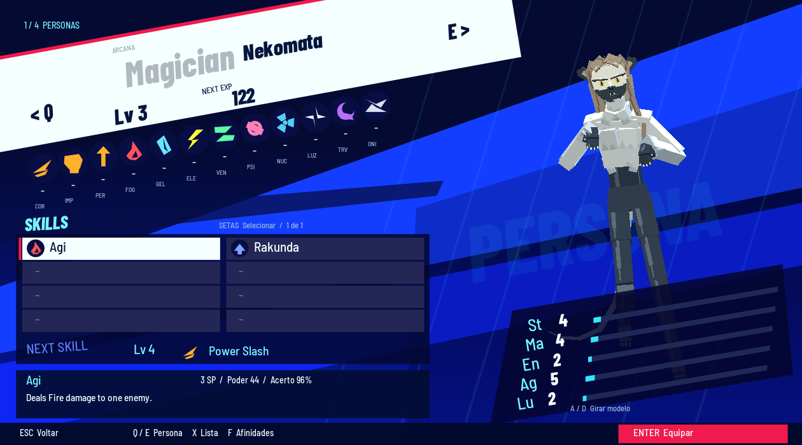

# 0.6.52 — Nekomata e correções da cidade

A Nekomata revisão 02 substitui o modelo anterior no mesmo ID, `nekomata`. O corpo, rosto, cabelo, olhos e cauda vêm do estudo aprovado: 266 cuboides nativos, 47 ossos, Box UV e textura de 1024 × 1024. A escala uniforme 0,125 compensa a grade de autoria 8×; o corpo animado ocupa aproximadamente dois blocos de altura. A conversão de eixos ocorre uma única vez na exportação para o GeckoLib.

O idle e os ataques físico e mágico estão ligados aos três clipes já usados pelo controlador. Os momentos principais de autoria foram alinhados ao impacto de combate em 1,4 segundo; ambos os ataques terminam em 2,5 segundos. Os giros completos e a recuperação foram preservados. O menu recebeu limites recalculados a partir da geometria animada, e a carta de fusão foi renderizada com o novo modelo. Estatísticas, habilidades, fusões, IDs de saves e item de colocação no criativo permanecem compatíveis.

Os ataques usam os trechos de Reload observados no vídeo [Persona 3 ALL Skills Showcase & Comparison](https://www.youtube.com/watch?v=TZap-dV5Oyo): Power Slash em 10,30–11,30 s e Agi em 333,75–335,06 s. O ritmo de 3,2 segundos do idle continua aproximado: as referências confirmam a postura, mas não o ciclo completo. São animações reconstruídas para o rig do projeto.

## Cidade

Inclui as correções preparadas durante a revisão da Nekomata, anteriormente retidas na 0.6.51:

- Fachadas, janelas, pilares, fechamentos do hall e coberturas das galerias da Gekkoukan. Mantém os 22 ambientes conectados e o pátio aberto com árvores de blocos do Minecraft.
- Batentes e folhas das portas do dormitório afastados das superfícies sobrepostas. Ornamentos da entrada giram inteiros com as dobradiças, sem fragmentos suspensos no vão.
- Conversão para quadriláteros nativos com duas metades válidas, preservando a área dos triângulos e evitando tangentes degeneradas.
- Migração para a planta 5, com estados de portas e IDs antigos preservados; restauração da escola após a Dark Hour antes da atualização da área.

Cliente e servidor devem usar esta versão: protocolo da cidade **6**. Não há novos IDs de itens/blocos. A HUD compacta, os demais modelos e os computadores seguem com o comportamento já aprovado. Detalhes arquitetônicos e scripts: [CITY-GEOMETRY.md](CITY-GEOMETRY.md).

## Fontes e validação

O modelo editável, textura, rig, animações, geradores e prévias aprovados estão em [tools/approved_models/nekomata](../tools/approved_models/nekomata/README.md). O relatório `integration.json` registra os hashes dos recursos de autoria e os parâmetros de exportação.

Na raiz do projeto, com Java 17 e Python com NumPy/Pillow:

```text
python tools/approved_models/import_nekomata.py
gradlew.bat --offline --no-daemon approvedModelsTest personaFramingExport --args=nekomata
gradlew.bat --offline --no-daemon personaFramingTest cityGeometryTest cityFunctionTest cityPolishTest
python tools/approved_models/preview_nekomata.py
gradlew.bat --offline --no-daemon jar sourcesJar
```

Verificações aprovadas: 742.962 condições dos modelos, 104.256 limites de enquadramento, 3.020.365 condições de geometria urbana, 4.741 de móveis/retornos e 43.406.514 de geometria local/restauração. A auditoria anterior de circulação e fechamentos foi preservada, e os recursos da cidade foram conferidos por SHA-256 para confirmar que correspondem aos já auditados.

As prévias usam os vértices carregados pelo GeckoLib e o layout de produção. São renders offline com iluminação ilustrativa. **Não houve execução do Minecraft nem validação visual em shader packs.**




