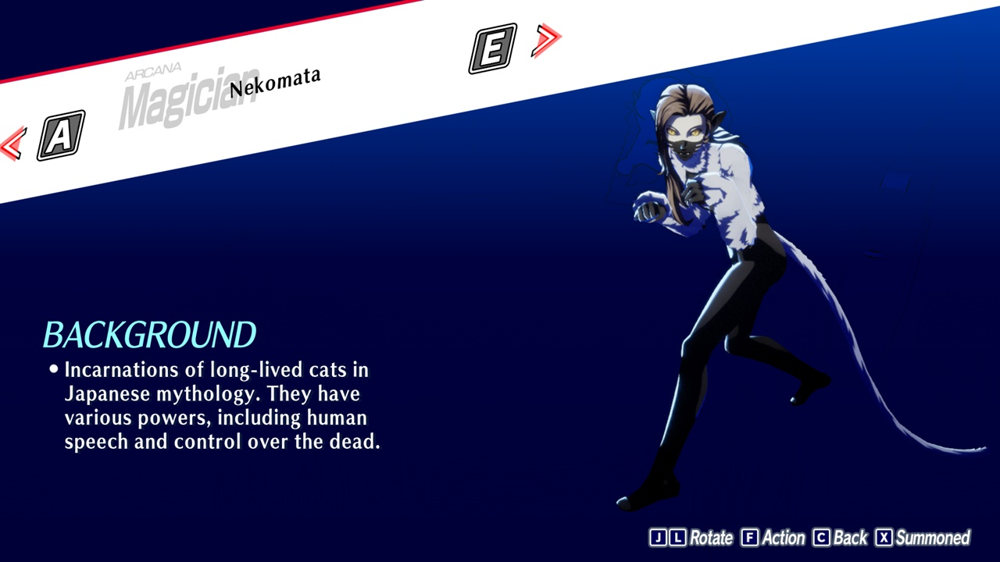
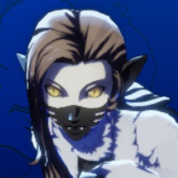

# Nekomata — auditoria de modelagem 01

13/10/2026 · Persona 3 Reload · estudo para aprovação, sem substituir a Persona no mod.

A direção proposta é refazer a Nekomata com silhueta esguia, rosto felino oval e expressivo, cabelo castanho penteado para trás, pelagem clara recortada e membros escuros. Os ataques físico e mágico fazem parte obrigatória da próxima modelagem, além do idle; não serão uma reutilização do gesto da Pixie.

## Referência principal e evidência

Captura de Persona 3 Reload publicada no [guia da Samurai Gamers](https://samurai-gamers.com/persona-3-reload/p3re-nekomata-persona-guide/). É a referência principal de proporção e postura: tronco inclinado, mãos em posição felina, perna dianteira estendida e outra recolhida. Na imagem, o cabelo é castanho com luzes claras, os membros inferiores são escuros e a pelagem do tronco/braços é branca. O azul forte deve ser tratado como influência da iluminação da cena, e não pintado como cor base de todo o pelo.

O recorte publicado no mesmo guia mostra íris douradas, pupilas escuras, nariz e região inferior do rosto escuros, área clara em torno dos olhos e orelhas pontudas. A leitura de cor é visual, não uma extração da textura oficial. Outra captura no [menu de Reload, publicada por Wefin_](https://gamebanana.com/mods/554313), confirma cabelo, pelagem e mãos em outro enquadramento; o menu desse registro foi modificado, por isso não o uso como referência de interface ou habilidades.

A cauda clara longa aparece inteira na vista principal. Não acrescentar uma segunda cauda completa por associação ao folclore: esta vista não comprova duas caudas separadas. Conferir a raiz e eventual bifurcação em uma vista traseira antes de fechar a geometria. A [galeria de Nekomata](https://megatenwiki.com/wiki/Gallery:Nekomata) separa versões de vários jogos; não misturar o desenho antigo de SMT, variantes de Dx2 ou fanarts com Reload.

## O que existe hoje no mod

Inspeção direta de `nekomata.geo.json`, PNG e animações, sem alterações nesses arquivos nesta entrega:

| Componente | Modelo atual | Direção para refazer |
|---|---|---|
| Geometria | 17 cuboides, 8 ossos | Silhueta própria, com detalhe concentrado em rosto, cabelo, mãos e pelagem |
| Cabeça | Caixa 6 × 6 × 5; focinho 4 × 3 × 2 | Crânio oval, têmporas inclinadas, queixo curto e focinho bem mais discreto |
| Olhos | Duas peças pequenas sobre a caixa | Pálpebras modeladas rasas; íris dourada e pupila escura legíveis na textura |
| Cabelo | Não há grupo dedicado | Massa superior contínua, risca central e mechas longas acompanhando pescoço/ombro |
| Braços/pernas | Ossos únicos sem cotovelos/joelhos independentes | Braço, antebraço, mão; coxa, canela, pé; articulações encostadas |
| Cauda | Um cubo reto 1,4 × 2 × 7 | Cadeia articulada comprida, curva e afilada; base presa à pelve |
| Textura/UV | Atlas 64 × 8, 17 cubos com UV por face | Autoria nova com Box UV e atlas próprio, sem reaproveitar a textura mínima |
| Dimensões | 14 cubos têm tamanhos fracionários | Tamanhos inteiros na autoria ampliada; uma única escala global na integração |
| Animações | `misc.idle` 3 s; ataques de 2,5 s, rig limitado | Novos três clipes desenhados para o novo esqueleto |

Os UVs e tamanhos fracionários atuais são observações do arquivo de runtime GeckoLib; não significam, por si só, que ele seja inválido nesse carregador. São diferentes do padrão de autoria que adotamos para os novos modelos.

## Cinco características que precisam sobreviver à conversão em cubos

1. Cabeça estreita, orelhas triangulares escuras e contraste claro/escuro específico do rosto.
2. Olhos dourados com pupila; expressão atenta e felina, sem transformar o focinho numa caixa grande ou copiar a boca da Elizabeth.
3. Cabelo castanho em mechas compridas, penteado para trás; não branco e não uma coleção de placas soltas.
4. Pelagem branca formando o volume dos ombros, peito e mangas, com bordas recortadas; mãos e pernas escuras.
5. Corpo alongado na pose recolhida e cauda longa que continua a linha da pelve, com movimento secundário.

## Construção proposta

A cabeça será resolvida primeiro em frente, perfil e três quartos. Usar poucas peças inclinadas para crânio, bochechas e mandíbula; nariz curto em relevo e boca discreta. Nenhuma película plana deve substituir o volume da cabeça. As íris entram na textura; pálpebras em volume raso, sem placas que tampem os olhos. Revisar o conjunto em tamanho de menu e em aproximação, como fizemos após as correções da Elizabeth e da Pixie.

Tronco com tórax, cintura e pelve conectados; ombros dentro da massa de pelo. Manter mãos pequenas, palma e polegar separados e garras contidas. O pelo deve ser sugerido por recortes maiores e agrupamentos de pixels, evitando dezenas de espinhos finos. Cabelo principal ligado à cabeça; 2–3 mechas longas com articulação secundária para não atravessar o peito nos ataques.

Proporção inicial de estudo: aproximadamente 6,5–7 cabeças na altura do corpo ereto, incluindo o cabelo e excluindo as pontas das orelhas; é uma estimativa de projeto, não uma medida oficial. A postura do compêndio abaixa essa altura. Ajustar pela comparação de silhuetas antes de texturizar. Em jogo/menu, enquadrar pelos limites animados, reservando espaço para a cauda e as mãos; não usar uma escala arbitrária igual à de Jack Frost ou Apsaras.

Autoria proposta em grade uniforme ampliada 8×, cuboides nativos com dimensões inteiras, Box UV e orientação North. Root em (0,0,0), grupo `head`, nomes minúsculos, textura nítida com densidade uniforme. O atlas pode começar em 512 × 512 e crescer apenas se o empacotamento exigir; tamanho de atlas não é meta de qualidade. Exportar `.bbmodel`, `.geo.json`, PNG e `.animation.json`; converter eixos/escala uma única vez para GeckoLib, mantendo as fontes de autoria intactas. Convenções técnicas baseadas em [Creating a Model — Cobblemon](https://wiki.cobblemon.com/index.php/Tutorials/Creating_A_Model) e no [padrão local Izanagi/Igor](MODELING.md). A política de poucos cuboides, rosto modelado e revisão visual é nossa direção artística local.

Rig previsto: raiz → pelve → tórax → pescoço → cabeça; braços/antebraços/mãos ligados ao tórax; coxas/canelas/pés à pelve; cadeia da cauda à pelve; cabelo e orelhas à cabeça. Base de 30–40 ossos, a ajustar pela necessidade real. Cabelo e cauda terão limites de movimento para não cortar ombros, mãos ou pernas.

## Animações obrigatórias e poses-chave

**Estado da evidência:** confirmei a pose estática do compêndio. A pesquisa não forneceu uma sequência completa verificável dos dois ataques de Reload. Os movimentos abaixo são propostas autorais para revisão, não uma alegação de reprodução quadro a quadro do jogo. O [vídeo de fusão localizado](https://www.youtube.com/watch?v=jc1i-k20Cfc) é uma referência de apresentação a conferir, não evidência suficiente para certificar os ataques.

| Clipe | Proposta de movimento | Antecipação / ação / recuperação |
|---|---|---|
| Idle — `misc.idle` | Postura felina inclinada do compêndio, mãos diante do peito, uma perna recolhida; respiração leve, cauda em onda suave | Loop de estudo 3 s; pequenos ajustes de cabeça, orelhas e punhos; posição e velocidade contínuas na emenda |
| Físico — `action.physical` | Golpe curto de garra diagonal com uma mão; tórax acompanha o avanço, outra mão mantém a guarda; cauda contrabalança | 0–0,45 s: recua ombro/mão; 0,45–0,9 s: avança e corta; 0,9–1,4 s: desacelera; 1,4–2,5 s: retorna ao idle |
| Mágico — `action.magic` | Recolhe as mãos próximas ao peito, abre os dedos e projeta uma palma para lançar; mantém o rosto visível, perna recolhida e cauda curvada | 0–0,65 s: concentra; 0,65–1,05 s: abre/projeta a palma; 1,05–1,4 s: sustenta; 1,4–2,5 s: recolhe e retorna |

Os tempos são de estudo. Na integração futura, sincronizar contato/liberação com o marcador de impacto usado pelo combate, mantendo variantes físico/mágico claramente diferentes. Não alterar habilidades, atributos ou dano para acomodar a animação. Testar mãos visíveis nas duas câmeras laterais e no inspect. Efeitos mágicos ficam separados da geometria e não devem esconder rosto, dedos ou defeitos.

## Critérios de aprovação da próxima modelagem

- Primeira revisão: silhueta de corpo completo, cabeça frontal, perfil e três quartos, sob luz neutra; comparação com a captura principal na mesma orientação.
- Olhos com cor correta, pupilas presentes e simétricas; focinho curto e mandíbula oval sem blocos salientes.
- Braços, pescoço, pernas, pelo e cauda ligados em todas as poses; sem frestas ou faces coplanares piscando.
- Testar base e ponta da cauda em vista traseira antes de decidir qualquer bifurcação.
- GIFs de corpo inteiro de idle, físico e mágico, com nomes e tempo de impacto; mostrar também frente/três quartos do rosto durante os ataques.
- A prévia final deve sair dos mesmos cuboides, textura e clipes entregues. Storyboard ou ilustração não serão apresentados como modelo pronto.
- Só depois da revisão do estudo, preparar substituição do modelo antigo e conferir carregamento, escala, inspect e combate solo/multiplayer.

Entrega desta auditoria: referências, diagnóstico do asset atual, direção de forma/cor, rig e storyboard. **Ainda não é a modelagem final nem uma integração da nova Nekomata.**
