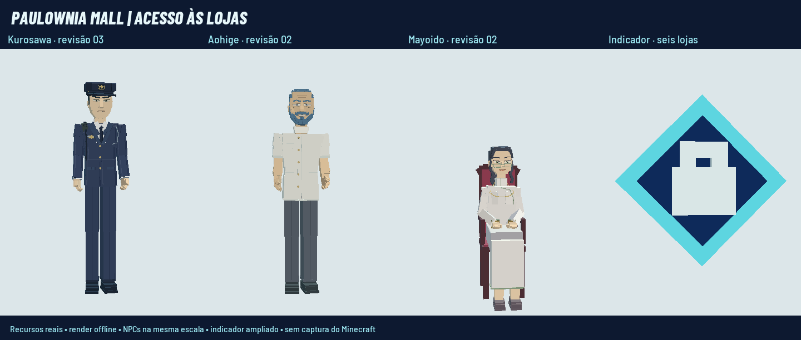

# Paulownia Mall — acesso por vendedores e indicadores

Versão **0.6.54-paulownia-shops**, 19/10/2026. O usuário encerrou a modelagem de outros atendentes e pediu indicadores nas lojas sem NPC; nas lojas com os modelos aprovados, o acesso passa pelo clique direito no vendedor. Após a revisão nas fontes, autorizou a integração e compilação da versão completa.

Esta versão inclui as mudanças já entregues: Personas aprovadas, cidade conectada, dormitório, Gekkoukan com escadas sustentadas, correções de portas e iluminação, HUD compacta, lojas, proteção contra quebra/colocação e funcionalidades da Velvet Room. A planta permanece na revisão 6; o protocolo de rede da cidade passa a **8** pelos novos registros de atendimento. Cliente e servidor precisam da mesma versão. Não é necessário recriar a cidade para que os vendedores apareçam.

| Loja | Acesso |
|---|---|
| Tatsumi East Police | Kurosawa, estudo 03 |
| Aohige Pharmacy | Proprietário, estudo 02 |
| Mayoido Antiques | Proprietária sentada, estudo 02 |
| Be Blue V | Indicador clicável |
| Chagall Café | Indicador clicável |
| Mandragora | Indicador clicável no piso superior |
| Game Parade | Indicador clicável |
| Club Escapade | Indicador clicável |
| Kenneth Arnold | Indicador clicável |

Os três vendedores mantêm a geometria, textura e idle aprovados. As animações são as adaptações documentadas nos estudos; não são clipes extraídos ou reproduções integralmente verificadas de Reload. Os seis indicadores compartilham um losango ciano com uma sacola e flutuação discreta. Ao mirar, aparece a instrução de clique direito, traduzida pela escolha de idioma do mod. Os menus, catálogos e preços existentes são reutilizados.

## Funcionamento

- Cada loja tem uma entidade persistente com UUID determinístico. A criação ocorre apenas com cidade pronta, chunk carregado e jogador próximo; não reconstrói a planta.
- A configuração `data/velvet_eclipse/city/shop-access.json` liga posição, orientação, escala, área de clique e bloco de atendimento real à loja correspondente. O tipo da entidade fixa a identidade da loja tanto no cliente quanto no servidor.
- O servidor exige cidade ativa, jogador disponível, entidade oficial presente e na posição prevista, distância de até seis blocos, linha de visão e balcão existente. Cada jogador recebe seu próprio token de atendimento; as transações revalidam a sessão.
- Nas três lojas com vendedor, clicar no balcão orienta o jogador a interagir com o NPC. Nas demais, o indicador abre a loja e o acesso anterior pelo próprio estabelecimento continua funcionando.
- Os vendedores e indicadores oficiais não recebem dano nem são empurrados. Não há IA de deslocamento.
- Os itens `city_police_model`, `city_aohige_model` e `city_mayoido_model` aparecem na categoria criativa de NPCs. Colocam cópias decorativas fora das dimensões protegidas; essas cópias não abrem transações e podem ser removidas com ataque em criativo.

## Recursos e reprodução

Fontes editáveis aprovadas: `tools/approved_models/shop_npcs/`. O exportador `tools/approved_models/export_shop_npcs.py` preserva cuboides inteiros, Box UV e tempos dos clipes, convertendo os eixos uma única vez para o carregamento GeckoLib. As texturas são cópias idênticas. Escala dos três NPCs: 0,09.

Com Java 17, executar `gradlew.bat --offline cityShopAccessTest`. O teste compila as fontes e verifica a política de acesso, os nove destinos, recursos nativos GeckoLib, itens criativos, localização e 117 poses contra as colisões da planta atual. Relatório em `build/reports/shop-access/validation.json`: **618.733 verificações aprovadas**. O teste não inicia Minecraft e não gera JAR.

Na preparação da 0.6.54 também passaram `localizationTest` (2.649 verificações), `cityFunctionTest` (4.705; 173 assentos, 34 portas e retornos) e `sceneryProtectionTest` (3.108.585 verificações de proteção, UVs e luz nos estados das portas). Os recursos existentes da cidade e das Personas e os 117 arquivos dos estudos aprovados foram comparados com os respectivos registros anteriores. Não foi repetida a bateria de áreas sem alterações.

Para empacotar a versão já validada: `gradlew.bat --offline jar sourcesJar`. O ZIP de entrega inclui fontes, recursos, ferramentas, wrapper e dependências. A instalação substitui somente o JAR do Velvet Eclipse e preserva a versão anterior em `mods/velvet-eclipse-versions/`.

A mesma versão inclui o [seletor de dificuldade e balanceamento por participantes](DIFFICULTY.md), com escolha do líder para a party e preferência pessoal no solo. Os quatro modos e as regras de multiplayer, táticas, raid e localização passaram nas verificações offline descritas nessa documentação.

`tools/approved_models/preview_shop_access.py` renderiza os arquivos nativos emitidos pelo teste em `build/reports/shop-access/shop-access-preview.png`. É uma prévia offline dos recursos, não uma captura da cidade nem validação dentro do jogo. Clique real, persistência após recarregar o mundo e sincronização multiplayer ainda dependem de validação em execução.

