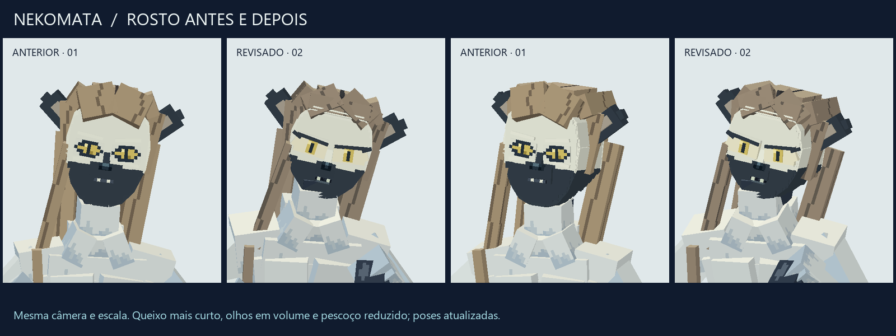
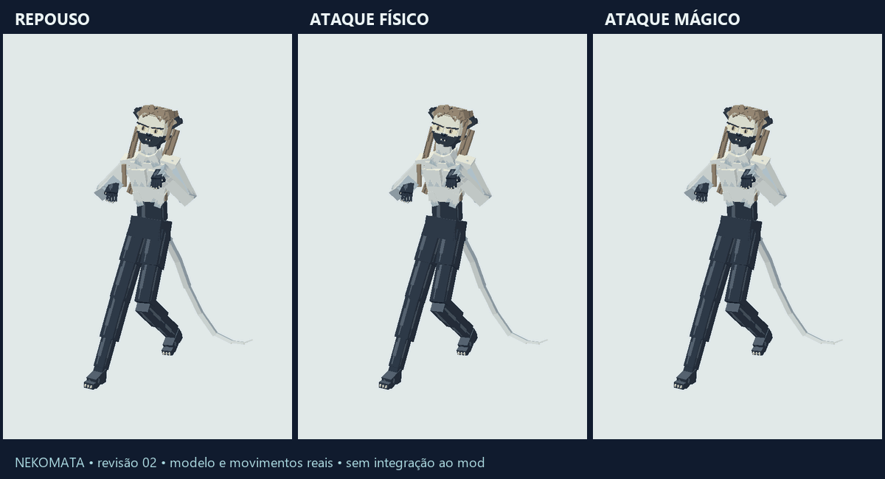
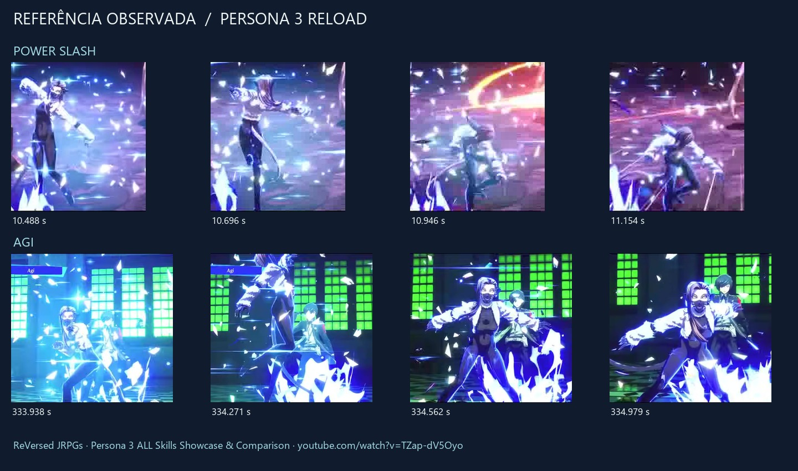
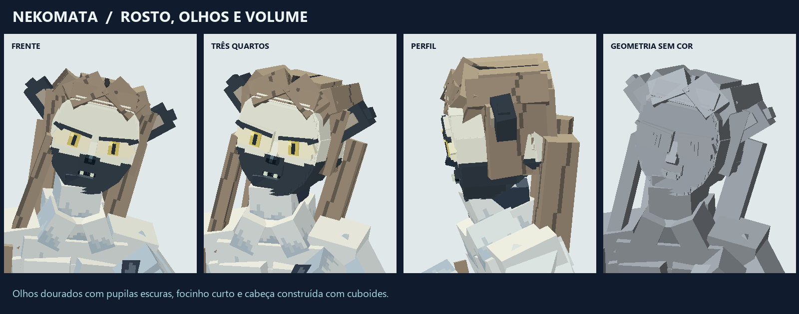
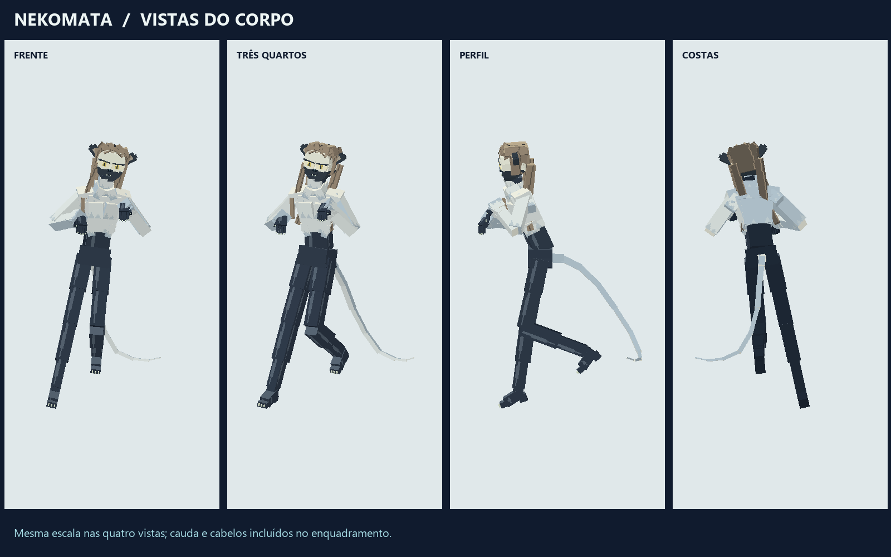

# Nekomata — revisão de modelagem 02

14/10/2026 · Velvet Eclipse · modelo independente para revisão.

O rosto, a postura de repouso e os dois ataques foram revistos. Esta entrega contém o **modelo real editável**, textura, rig, animações, comparação com a revisão 01 e GIFs produzidos dos recursos entregues. Não é uma versão final aprovada nem uma integração ao mod.

## Referências verificadas

O vídeo **[Persona 3 ALL Skills Showcase & Comparison | Portable Vs Reload](https://www.youtube.com/watch?v=TZap-dV5Oyo)**, de ReVersed JRPGs, foi examinado em quadros. Ele alterna Portable e Reload: somente os trechos de **Reload com a Nekomata** orientaram esta revisão.

| Movimento | Trecho observado | O que foi usado |
|---|---|---|
| Power Slash | [0:10–0:11](https://www.youtube.com/watch?v=TZap-dV5Oyo&t=10s), aproximadamente 10,30–11,30 s | Elevação do corpo, braços abertos, giro e varredura de garra; conclusão baixa, tronco à frente |
| Agi | [5:33–5:35](https://www.youtube.com/watch?v=TZap-dV5Oyo&t=333s), aproximadamente 333,75–335,06 s | Preparação recolhida, elevação, volta completa e conclusão com braço direito aberto e mão esquerda próxima do rosto |
| Repouso | Captura do compêndio e instantes anteriores ao Agi | Tronco inclinado, mãos recolhidas, uma perna flexionada e cauda longa; esses trechos não comprovam o período completo do loop |

Os vídeos anteriormente sugeridos, “Persona 3 Reload - Nekomata, Cursed Oni” e “How to fuse Nekomata”, foram descartados como evidência dos ataques após a correção do usuário. Não sustentam esta coreografia.

A aparência continua baseada na captura e no retrato de Reload publicados no [guia da Samurai Gamers](https://samurai-gamers.com/persona-3-reload/p3re-nekomata-persona-guide/), preservados em references/. A **Elizabeth revisão 05**, aprovada no projeto, foi usada como exemplo de construção de rosto feminino: contorno oval, queixo curto, nariz contínuo e olhos/pálpebras em volumes rasos. Isso não significa copiar os traços humanos da Elizabeth para a Nekomata.

## Rosto e postura

- **Cabeça:** contorno encurtado, bochechas mais cheias e transição facetada para um queixo curto. Os cuboides ficam contidos no contorno para evitar pontas ocultas projetando-se no perfil.
- **Olhos:** esclera, íris douradas, pupilas escuras e pequenos reflexos são elementos separados. As pálpebras e os cílios são rasos, sem o anel escuro do estudo 01.
- **Nariz e boca:** ponte curta ligada à ponta, focinho escuro, boca pequena e duas presas discretas. Preservada a divisão clara/escura característica do rosto.
- **Cabelo:** raiz frontal coberta e mechas superiores inclinadas para sugerir a risca e o penteado para trás. Mechas longas continuam articuladas. O cabelo permanece uma estilização em cuboides.
- **Pescoço e idle:** cabeça mais próxima dos ombros, tronco mais inclinado, mão esquerda mais recolhida ao peito e posição das pernas revisada. A respiração e o balanço secundário são discretos.

A prancha de antes/depois usa a mesma câmera e escala por unidade, com cada cabeça centralizada no enquadramento. As poses foram atualizadas, portanto a inclinação não é idêntica. Não há retoque pintado sobre os renders.

## Animações entregues

| Clipe | Duração | Ação da revisão 02 |
|---|---:|---|
| animation.nekomata.ground_idle | 3,2 s, loop | Postura felina mais curvada, mãos recolhidas, respiração e balanço de perna, orelhas, cabelos e cauda |
| animation.nekomata.physical_attack | 2,5 s | Preparação baixa, subida com braços abertos, giro completo, varredura da garra e conclusão baixa; referência Power Slash |
| animation.nekomata.magic_attack | 2,8 s | Elevação, giro completo, braço direito aberto e palma esquerda junto ao rosto; referência Agi |

- [GIF do idle](draft/nekomata-idle-02.gif)
- [GIF do ataque físico](draft/nekomata-physical-02.gif)
- [GIF do ataque mágico](draft/nekomata-magic-02.gif)
- [Inspeção do corpo em 360°](draft/nekomata-turntable-02.gif)
- [Poses do físico](draft/nekomata-physical-poses-02.png)
- [Poses do mágico](draft/nekomata-magic-poses-02.png)

Os momentos principais de autoria são 0,91 s no físico e 1,10 s no mágico. Não são marcadores já conectados ao combate do mod. Nos vídeos, a invocação desaparece depois da ação; a transição suave de volta ao repouso foi criada para este rig. As durações totais incluem essa recuperação.

**Limite da referência:** os ataques agora têm evidência visual verificada, mas continuam reconstruções manuais para cuboides, não captura de movimento. O período de 3,2 s e a amplitude do idle são aproximações; falta um vídeo com o loop completo para acertar sua cadência. As cores da magia no vídeo não foram pintadas na textura, nem foram adicionados efeitos que escondam as articulações.

## Regras de modelagem

266 cuboides · 47 ossos · atlas 1024 × 1024 · Box UV · grade uniforme 8×.

O padrão segue o [tutorial do Cobblemon](https://wiki.cobblemon.com/index.php/Tutorials/Creating_A_Model) e as [regras locais](references/MODELING.md): elementos Bedrock nativos, dimensões inteiras positivas na grade ampliada, orientação North, raiz em zero, grupo head, nomes minúsculos, hierarquia articulada e pintura em pixels. Não há malha suave, elipsoide, escala animada ou cabeça substituída por um plano com uma imagem.

O encaixe facial usa 128 cuboides nativos dentro de planos de contorno definidos na autoria. O restante forma corpo, feições, cabelo, membros, dedos e cauda. O atlas tem densidade uniforme e ocupa 307 linhas; o espaço restante não representa detalhe extra. Simplificar peças que não contribuam para a forma continua possível na revisão estética.

Na futura integração, a conversão de eixos e a escala global devem ocorrer uma única vez. Os JSONs deste estudo não devem ser copiados diretamente para o mod. A escala em combate e no menu ainda não foi definida nesta etapa.

## Arquivos e reprodução

- **draft/nekomata.bbmodel:** modelo editável com textura incorporada, ossos e três animações.
- **draft/nekomata.geo.json**, **nekomata.animation.json**, **nekomata.png:** recursos separados de autoria.
- geometry.py, head_geometry.py e facial_volume.json: corpo e cabeça.
- materials.py: paleta e textura em pixels.
- animate_model.py e rig_math.py: poses, trajetórias e articulações.
- render_model.py e present_model.py: renderização das imagens e GIFs.
- compare_revision.py: comparação com o estudo 01 e prancha dos trechos observados.
- verify_model.py, NativeModelCheck.java e package_model.py: verificação e empacotamento.

Para reconstruir, com Python, NumPy e Pillow:

~~~text
python build_model.py
python verify_model.py
python present_model.py
python package_model.py
~~~

Antes do empacotamento, executar também NativeModelCheck com Java 17 e as dependências locais do projeto. fit_face.py só é necessário ao alterar o contorno facial e exige SciPy; o resultado calculado já está incluído. As legendas usam a fonte Segoe UI. compare_revision.py depende da revisão 01 e dos quadros de pesquisa no diretório work; as pranchas prontas estão incluídas, os vídeos completos não.

O verificador de preservação usa o manifesto relativo ao workspace original. Em outro computador, os recursos e a renderização continuam utilizáveis; a auditoria dos arquivos do mod exige a mesma base local.

## Verificação e limites

- **Passou:** 6.353 verificações, incluindo dimensões inteiras, Box UV sem sobreposição, hierarquia, atlas, textura incorporada e íris/pupilas modeladas.
- **Passou:** 243 poses amostradas e 34 pares com contato, incluindo nariz, olhos, membros, dedos e segmentos da cauda.
- **Passou:** rotações contínuas, volta completa preservada nos arquivos e retorno dos ataques à pose de repouso.
- **Passou:** leitura e construção pelo GeckoLib — 266 cuboides, 47 ossos e três clipes.
- **Passou:** preservação por SHA-256 dos 4.501 arquivos de fontes, recursos e configuração do mod.
- As prévias têm enquadramento calculado a partir dos vértices animados e hashes dos recursos renderizados.

Relatórios em draft/validation.json, native-validation.json, framing-validation.json e media-validation.json. O contato cobre os pares declarados, não todas as interseções possíveis. A leitura pelo GeckoLib comprova estrutura e carregamento; não equivale à validação de escala, eixos ou aparência dentro do Minecraft.

**Nenhum JAR foi gerado, instalado ou publicado.** A revisão 01 foi preservada. A aprovação visual do modelo permanece pendente.

## Fontes

- ReVersed JRPGs, Persona 3 ALL Skills Showcase & Comparison | Portable Vs Reload: https://www.youtube.com/watch?v=TZap-dV5Oyo
- Samurai Gamers, Nekomata Persona Guide: https://samurai-gamers.com/persona-3-reload/p3re-nekomata-persona-guide/
- Captura do compêndio: https://samurai-gamers.com/wp-content/uploads/2024/08/sg-p3r-magician-nekomata.jpg
- Cobblemon Wiki: https://wiki.cobblemon.com/index.php/Tutorials/Creating_A_Model

Referências de terceiros servem à análise comparativa. Geometria, textura e animações do estudo foram construídas no projeto; nenhum arquivo de modelo ou animação do jogo foi extraído.
